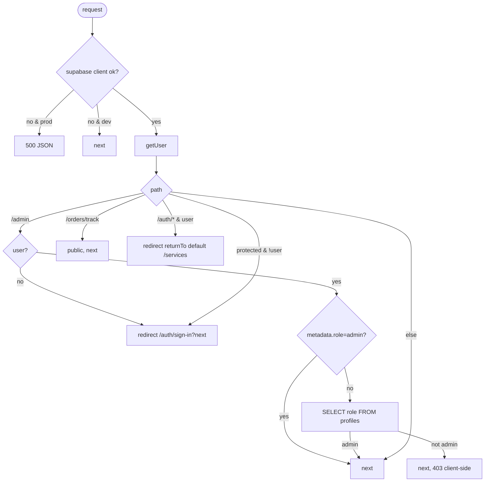
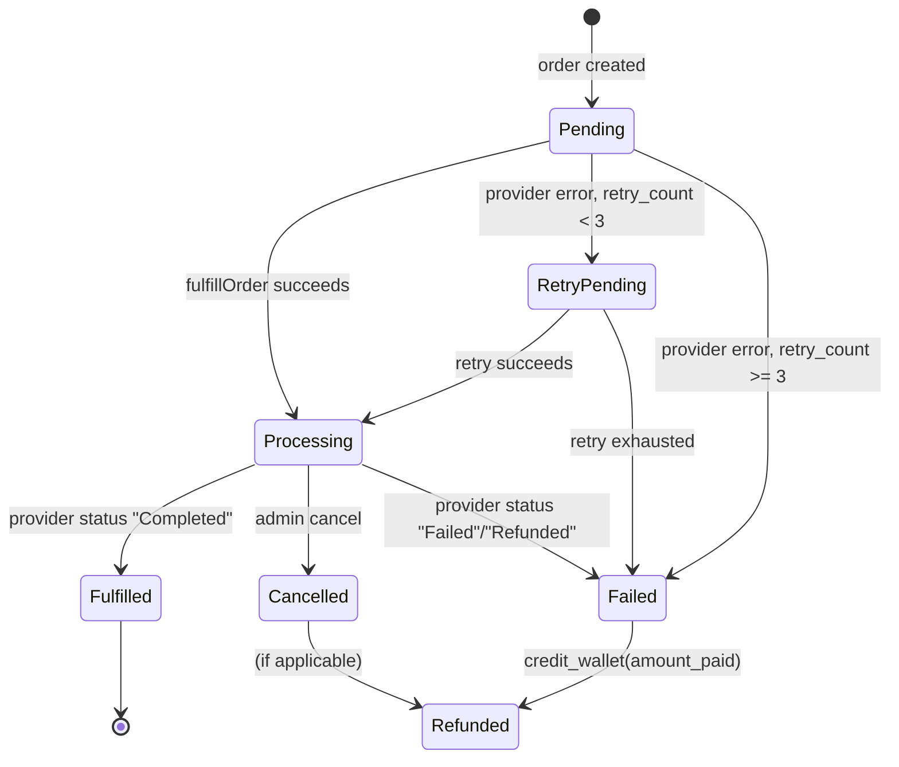

# 9. Diagrams

ASCII / Mermaid flow diagrams for the build. Each diagram is self-contained
and references the document that contains its ground truth.

## 9.1 Money flow (the critical path)
```
                    CUSTOMER
                       │
                       ▼
              ┌────────────────┐
              │  OrderForm     │
              │  (wallet)      │─── POST /api/orders ───┐
              │  (mpesa)       │                        │
              │  (guest)       │─── POST /api/orders/anonymous
              └────────┬───────┘                        │
                       │                                │
                       ▼                                ▼
              ┌─────────────────────────────────────────────────────┐
              │              POST /api/orders                       │
              │  1. validate + server-side price check              │
              │  2. [wallet] debit_wallet RPC ──────────────────┐   │
              │  3. INSERT orders (payment_status=paid|pending)  │   │
              │  4. [mpesa] return early ────────────────────────┘   │
              │  5. [wallet] fulfillOrder(order.id)               │
              └──────────────────────┬──────────────────────────────┘
                                     │
                                     ▼
              ┌─────────────────────────────────────────────────────┐
              │           POST /api/mpesa/stk-push                  │
              │  INSERT wallet_transactions (reference=CheckoutReqID │
              │  related_order_id, status="pending")                │
              │  initiateStkPush → Safaricom Daraja                  │
              └──────────────────────┬──────────────────────────────┘
                                     │
                                     ▼
              ┌─────────────────────────────────────────────────────┐
              │        POST /api/mpesa/callback  (Safaricom)        │
              │  resultCode !== "0" → tx.status = "failed"          │
              │  resultCode === "0" → completeStkPayment:           │
              │    ├─ idempotency: already "completed" → no-op      │
              │    ├─ UPDATE tx.status = "completed"                │
              │    ├─ [related_order_id]                            │
              │    │   ├─ UPDATE orders payment_status="paid"       │
              │    │   └─ fulfillOrder(order.id)  ◄──┐              │
              │    └─ [wallet top-up]                              │ │
              │        └─ credit_wallet RPC ──────────────────────┘ │
              │                                                     │
              │  ┌──────────────────────────────────────────┐      │
              │  │        fulfillOrder                      │      │
              │  │  placeProviderOrder → provider_order_id  │      │
              │  │  UPDATE orders fulfillment_status=proc   │      │
              │  │  (cron 5min) syncOrderStatuses →         │      │
              │  │    "Completed" → "fulfilled"             │      │
              │  └──────────────────────────────────────────┘      │
              └─────────────────────────────────────────────────────┘
```

## 9.2 Auth decision tree (middleware)


## 9.3 Fulfillment state machine


## 9.4 M-Pesa callback idempotency
```mermaid
flowchart LR
    A[Safaricom POST] --> B{completeStkPayment}
    B --> C{tx.status == completed?}
    C -- yes --> D[return alreadyCompleted<br/>NO double-credit]
    C -- no --> E{tx.status == pending?}
    E -- no --> F[throw "already <status>"]
    E -- yes --> G[UPDATE status=completed<br/>WHERE status=pending]
    G --> H{related_order_id?}
    H -- yes --> I[UPDATE orders paid<br/>fulfillOrder]
    H -- no --> J[credit_wallet]
    I --> K[notification + email]
    J --> K
    K --> L[return credited:true]
    B -.->|throws| M[500, keep PENDING<br/>Safaricom redelivers]
```